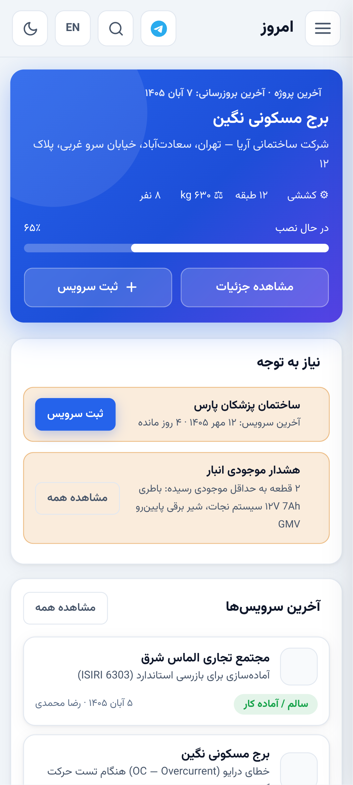
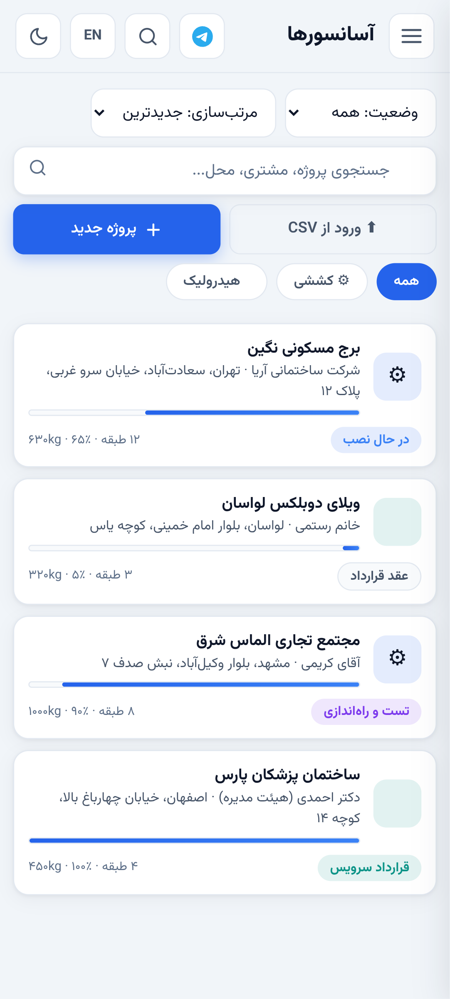
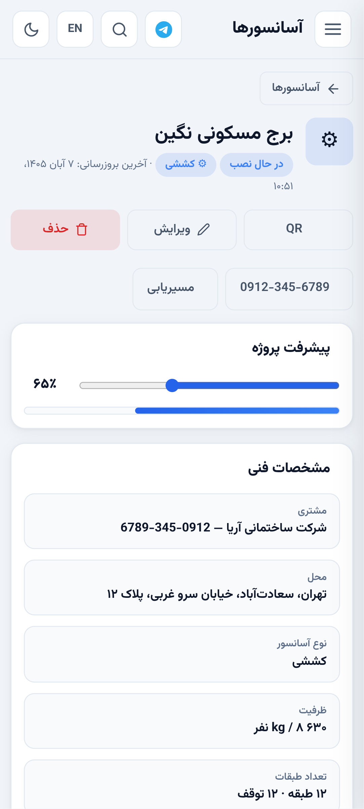

# Z Lift — دستیار حرفه‌ای تکنسین آسانسور

**اپلیکیشن وب پیشرونده (PWA) و کاملاً آفلاین** برای تکنسین‌های آسانسور: ساختمان‌های چندآسانسوره، گزارش سرویس با عکس و امضا، چک‌لیست EN 81-20/50، عیب‌یابی تعاملی، محاسبات مهندسی، فاکتور و قرارداد، تقویم جلالی و پشتیبان‌گیری امن — بدون هیچ سرور یا بک‌اندی؛ همهٔ داده روی خودِ دستگاه می‌ماند.

[](https://github.com/Zhakar-Ata/Z-Lift/actions/workflows/ci.yml)
· نسخهٔ `29.7.2` · فرمت بکاپ `v8` · طرح داده `v3` · فارسی/English · راست‌چین

<p>
  
  
  
</p>

## امکانات

- **ساختمان و آسانسورها (چندشفته):** هر ساختمان چند آسانسور مستقل دارد؛ سرویس، چک‌لیست، قطعه، قرارداد و اندازه‌گیری به همان شفت وصل است و داشبورد موعد هر شفت را جدا نشان می‌دهد. برای هر شفت یک QR چاپی جدا هم ساخته می‌شود تا با اسکن، مستقیم روی همان شفت باز شود.
- **گزارش سرویس و تعمیرات:** عکس فشرده‌شده، امضای مشتری روی بوم، قطعات مصرفی از انبار، چاپ رسید A4، تأیید مشتری و اشتراک‌گذاری.
- **چک‌لیست استاندارد EN 81-20/50** با وضعیت بندبه‌بند و ذخیرهٔ خودکار پیش‌نویس؛ **عیب‌یابی تعاملی** با ۲۲ سناریوی دوزبانهٔ گام‌به‌گام؛ **محاسبات مهندسی** و پارامترهای درایو VVVF.
- **مالی:** فاکتور رسمی با شمارهٔ یکتای هر دستگاه (`ZL-…`)، مالیات و تخفیف، گردش حساب و قرارداد سرویس سالانه؛ انبار قطعات با هشدار اتمام.
- **اندازه‌گیری ساختاریافتهٔ بازرسی** (چاهک، فاصله‌ها، مقاومت‌ها، سرعت، جریان و…) با چاپ برگهٔ اندازه‌گیری.
- **تقویم جلالی و یادآور موعد سرویس**، به‌همراه اپلیکیشن نصب‌شونده با میانبرهای «سرویس جدید» و «ساختمان‌ها».
- **دو گوشی، بدون ابر:** ایمپورت ادغامیِ فایل بکاپ — رکوردها بر اساس تازگی ترکیب می‌شوند، تداخل‌ها گزارش می‌شوند و قبل از هر تغییری یک اسنپ‌شات ایمنی برای برگشت ساخته می‌شود. ایمپورت لیست ساختمان‌ها از CSV هم پشتیبانی می‌شود (سربرگ فارسی/انگلیسی، ارقام فارسی).
- **حساب‌های مجزا روی یک دستگاه:** هر کاربر فضای کاری خودش را دارد؛ رمزها با PBKDF2 ذخیره می‌شوند و تلاش‌های ناموفق ورود تأخیر تصاعدی می‌گیرند.

## اجرا

فایل‌های استاتیک‌اند؛ هر وب‌سروری کار می‌کند:

```bash
python3 -m http.server 8080
# سپس http://localhost:8080
```

برای نصب به‌صورت اپ (آیکون روی صفحهٔ اصلی) باید روی HTTPS (یا `localhost`) سرو شود. حساب نمایشی: کاربر `tech` با رمز `123456`؛ حساب تازه بسازید، فضای خالی خودش را دارد.

## معماری

- **بدون بک‌اند:** صددرصد آفلاین. پایگاه‌دادهٔ اصلی IndexedDB (`zlift-data`) است؛ عکس‌ها در استور دوم همان دیتابیس به‌صورت Data URL فشرده و جدا از رکورد اصلی نگه داشته می‌شوند تا لیست‌ها سبک بمانند. اگر IndexedDB در دسترس نباشد، اپ به‌طور خودکار روی localStorage ادامه می‌دهد.
- **Service Worker:** پیش‌کش اتمیک (همه یا هیچ‌کدام) تا نسخهٔ نیمه‌کاره هیچ‌وقت فعال نشود؛ راهبرد network-first برای به‌روز شدن شفاف.
- **حریم خصوصی:** هیچ داده‌ای دستگاه را ترک نمی‌کند مگر فایل بکاپی که خودِ کاربر خروجی می‌گیرد. فرمت بکاپ `v8` یک JSON خودکفاست که صحت آن پیش از ایمپورت بررسی می‌شود.
- **امنیت حساب:** هش رمز PBKDF2-HMAC-SHA-256 (۲۵۰ هزار تکرار، نمک ۱۶ بایتی) با ارتقای خودکار هش‌های قدیمی هنگام ورود؛ تأخیر تصاعدیِ ورودِ ناموفق بدون قفل دائمی.

## ساختار پروژه

| مسیر | نقش |
|---|---|
| `index.html` / `css/` | شِل اپ، اسپلش بوت، سیستم طراحی و تم‌ها |
| `js/core/` | هسته: ثابت‌ها و زیرساخت مشترک |
| `js/database/` | ذخیره‌سازی، بکاپ (`v8`) و ایمپورت ادغامی |
| `js/services/` | لایهٔ API دامنه (سرویس، ساختمان، مالی، اندازه‌گیری، …) |
| `js/modules/` | صفحه‌ها و ابزارهای UI |
| `js/data/` | ترجمه‌ها (fa/en)، چک‌لیست، دادهٔ عیب‌یابی و استانداردها |
| `qa/` | سوئیت‌های تست خودکار (jsdom + Chromium واقعی) |
| `docs/` | اسناد ممیزی، طراحی و چک‌لیست QA روی دستگاه واقعی |

## توسعه و تست

نیازمندی: Node.js نسخهٔ ۲۰ یا بالاتر.

```bash
npm install
npm test               # سوئیت‌های اصلی نویسنده — ۴۸۰ چک
npm run test:real-user # ممیزی کاربران واقعی — ۵۳ چک
npm run test:personas  # پرسوناهای میدانی — ۴۵ چک
npm run test:elevators # پین‌های چندآسانسوری — ۹ چک
npm run test:platform  # پلتفرم: امنیت، QR، CSV، ادغام بکاپ — ۲۱ چک
npm run test:android   # شبیه‌ساز اندروید روی Chromium واقعی — ۱۵ چک
npm run lint           # بررسی صحت کد (ESLint)
```

مجموع **۶۲۳ چک خودکار** که روی هر Pull Request با GitHub Actions اجرا می‌شوند. چک‌لیست نهایی روی گوشی واقعی: [`docs/DEVICE_QA.md`](docs/DEVICE_QA.md).

## اسناد

- [CHANGELOG](CHANGELOG.md) — تاریخچهٔ نسخه‌ها
- [`docs/DEVICE_QA.md`](docs/DEVICE_QA.md) — چک‌لیست QA روی دستگاه واقعی
- [`docs/REAL_USER_AUDIT.md`](docs/REAL_USER_AUDIT.md) · [`docs/PERSONA_TESTING.md`](docs/PERSONA_TESTING.md) — ممیزی‌های کاربر و پرسونا
- [`docs/PHASE2B1_DATA_MODEL_MIGRATION.md`](docs/PHASE2B1_DATA_MODEL_MIGRATION.md) · [`docs/PHASE2B2_API_APPLICATION_LAYER.md`](docs/PHASE2B2_API_APPLICATION_LAYER.md) — معماری داده و لایهٔ API
- [`docs/ARCHIVE_BUTTON_FIX.md`](docs/ARCHIVE_BUTTON_FIX.md) — یادداشت اصلاح بایگانی

## English

**Z Lift** is an offline-first PWA for elevator service technicians (Persian RTL first, full English UI): multi-elevator buildings, service reports with photo + customer signature, EN 81-20/50 checklists, step-by-step diagnostics, engineering calculators, invoicing with per-device unique numbers, a Jalali calendar, and verified local backups with two-device merge import. No backend — data never leaves the device except in backup files the user exports. 623 automated checks (jsdom suites + a real-Chromium Android simulation) run in CI on every change.
